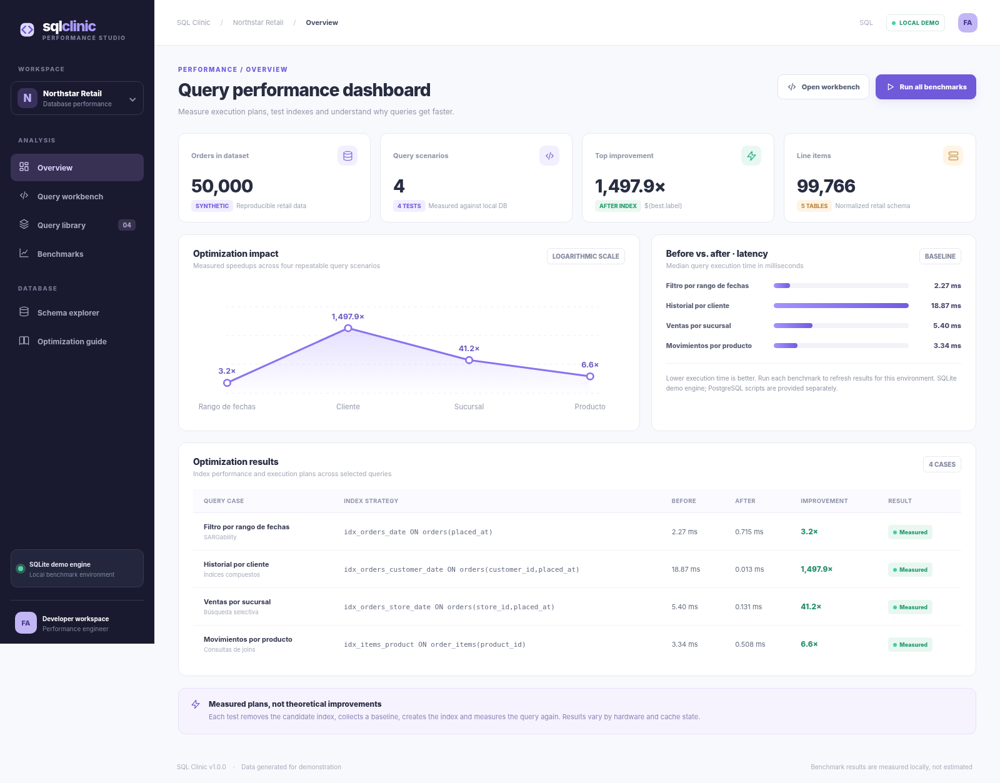
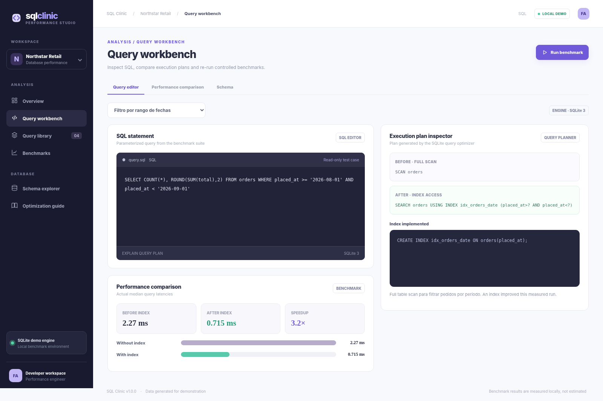
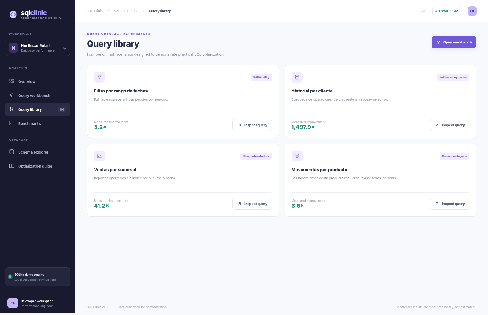
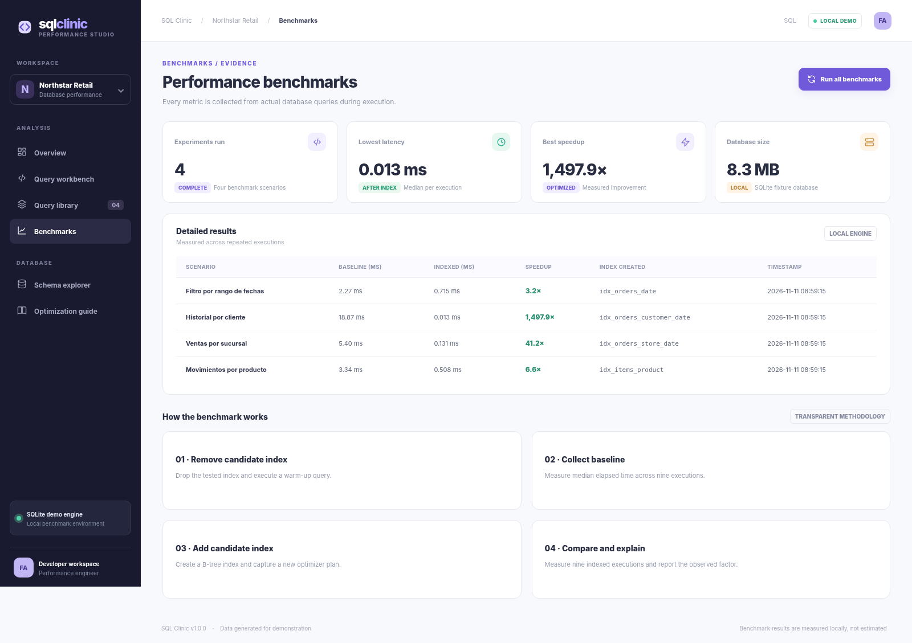
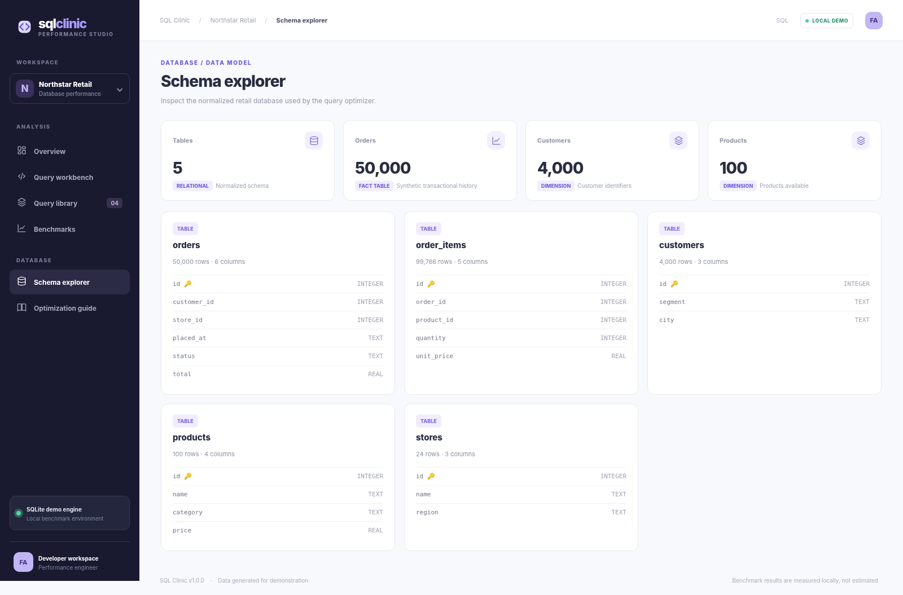

<div align="center">

# SQL Clinic
**Query tuning · Execution plans · Index benchmarking**

Laboratorio interactivo para **diagnosticar consultas SQL lentas, experimentar con índices y medir resultados** sobre una base de datos de comercio sintético.

   

</div>



## ¿Qué demuestra?

La habilidad de identificar cuellos de botella en consultas SQL, interpretar los planes de ejecución y evaluar cuándo conviene agregar un índice. Usa un dataset reproducible con **50.000 pedidos, casi 100.000 ítems, 4.000 clientes, 100 productos y 24 sucursales**.

> **Dataset 100 % sintético.** Northstar Retail es una empresa ficticia utilizada como contexto de laboratorio. Los tiempos son mediciones del entorno donde se ejecutaron; no son garantías de rendimiento de otros sistemas. No requiere publicar una aplicación ni contratar servicios.

## Funcionalidades

- Ejecutar **4 casos de optimización SQL** y revisar su consulta parametrizada.
- Comparar la latencia **antes/después** de índices sobre fecha, cliente, sucursal y producto.
- Ver la salida real de **`EXPLAIN QUERY PLAN`** de SQLite antes y después de cada cambio.
- Medir con reloj monotónico de alta resolución y **mediana de 9 ejecuciones** tras calentamiento inicial.
- Explorar el esquema relacional, índice aplicado, tabla y campos.
- Abrir el banco de consultas, dashboard, workbench, explicación y resultados.
- Ejecutar un laboratorio adicional de **PostgreSQL 16 / EXPLAIN (ANALYZE, BUFFERS)** mediante Docker y un script de migración real.

## Capturas

| Workbench y planes de ejecución | Biblioteca de consultas |
|:--:|:--:|
|  |  |
| **Rendimiento** | **Explorador de esquema** |
|  |  |

*Las pantallas muestran la interfaz que acompaña al código, renderizada con salidas medidas del backend de demostración. Los valores cambian en cada ejecución.*

## Tecnologías aplicadas

| Área | Herramientas |
|---|---|
| SQL | SQLite + DDL / SQL PostgreSQL |
| Optimización | B-tree, índices compuestos, filtros selectivos, `EXPLAIN` |
| Benchmarking | `time.perf_counter_ns`, `statistics.median`, repetición de pruebas |
| Backend | Python + FastAPI, servicio de consulta y medición |
| Frontend | HTML + CSS + JavaScript, SVG reactivo, API REST |
| Reproducibilidad | Semilla determinista, SQL de ejemplo, Docker Compose opcional |
| Pruebas | Pytest, CI de GitHub Actions |

## Ejecutar localmente

**Requisitos:** Python 3.12+, sin necesidad de Docker para la demo web.

```bash
python -m venv .venv
```

Activa el entorno: Windows PowerShell `.venv\Scripts\Activate.ps1`, Linux/macOS `source .venv/bin/activate`.

```bash
pip install -r requirements.txt
python tools/seed.py
python -m uvicorn app.main:app --reload --port 8010
```

Abre **http://127.0.0.1:8010**. En la primera carga la API crea las tablas, genera los registros y ejecuta cuatro benchmarks; posteriormente los botones permiten recalcular los tiempos.

Reiniciar dataset:

```bash
python -c "from tools.seed import seed; seed(force=True)"
```

## Laboratorio PostgreSQL (opcional)

```bash
docker compose up -d
pip install "psycopg[binary]"
python -m tools.benchmark_postgres
```

Esto crea PostgreSQL 16 en `localhost:5435`, copia los datos locales a PostgreSQL, ejecuta `EXPLAIN (ANALYZE, BUFFERS)` antes y después de los cuatro índices y guarda planes en `docs/postgres_*_plans.txt` **cuando lo ejecutes**. El script no necesita la interfaz web y no modifica las métricas mostradas por la demo SQLite.

> **Importante:** no se incluye una captura que pretenda mostrar PostgreSQL ejecutándose. Las capturas y mediciones del dashboard son de **SQLite**. Los scripts PostgreSQL son una implementación adicional y su ejecución requiere Docker.

## Casos de estudio

| Caso | Optimización | Evidencia |
|---|---|---|
| Rango de fechas | `orders(placed_at)` | Índice para filtro de período |
| Historial de cliente | `orders(customer_id, placed_at)` | Índice compuesto con ordenamiento |
| Ventas por sucursal | `orders(store_id, placed_at)` | Filtro por sucursal y fecha |
| Movimientos por producto | `order_items(product_id)` | Acceso por clave en tabla de detalle |

Los resultados son **dependientes del equipo**. Para una base de datos pequeña, un plan que recorre la tabla completa puede ser mejor que un índice. El objetivo es analizar planes y medir, no maximizar un factor de velocidad ficticio.

## API REST

| Método | Ruta | Descripción |
|---|---|---|
| GET | `/api/overview` | Cifras, casos medidos y tamaño del dataset |
| GET | `/api/cases` | Catálogo de 4 consultas |
| POST | `/api/benchmark/{case}` | Ejecutar caso de prueba e índices |
| GET | `/api/schema` | Tablas, columnas y conteos |
| GET | `/docs` | Swagger / OpenAPI |

## Pruebas

```bash
pip install -r requirements-dev.txt
python -m pytest -q
node --check frontend/app.js
```

4 pruebas básicas cubren datos semilla, cambios del plan, duraciones reales y endpoints. No hay pruebas de estrés ni validación de producción.

## Estructura del repositorio

```text
SQLClinic/
├── app/                   # FastAPI y banco de benchmarks
├── frontend/              # Interfaz y estilos
├── data/sqlclinic.sqlite3 # Dataset SQL de demostración
├── tools/                 # Generación y laboratorio opcional PostgreSQL
├── sql/                   # DDL y EXPLAIN ANALYZE de PostgreSQL
├── tests/                 # Tests de consulta y API
├── docs/screenshots/      # 5 pantallas reales
├── .github/workflows/     # CI
├── docker-compose.yml
└── README.md
```

Detalles en [Arquitectura y metodología](docs/ARCHITECTURE.md).

### Relación con DataBridge

Ambos repositorios exploran necesidades de un comercio ficticio: **DataBridge integra y limpia información**, y **SQL Clinic enseña a acelerar consultas sobre datos comerciales**. No comparten tablas físicamente ni dependen uno del otro: se pueden publicar y ejecutar individualmente.

## Licencia

MIT. Ejercicios destinados a aprendizaje técnico y portafolio.
