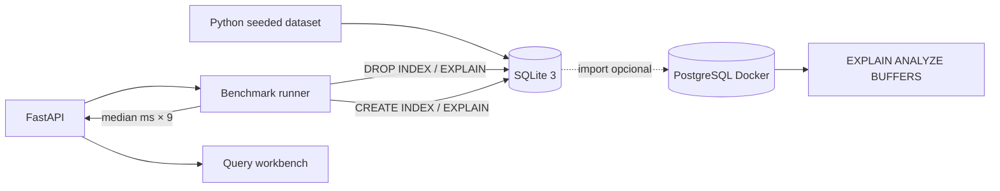

# SQL Clinic — Arquitectura, medición y límites

## Flujo

## Metodología

1. `seed()` crea 50.000 órdenes, ~100.000 líneas de pedido, 4.000 clientes, 100 productos, 24 sucursales. Semilla constante (`202610`).
2. `run_case()` elimina únicamente el índice que está evaluando en ese caso.
3. Ejecuta un calentamiento y recoge `EXPLAIN QUERY PLAN` y la mediana en 9 iteraciones con `perf_counter_ns`.
4. Crea el índice propuesto, vuelve a calentar, guarda el nuevo plan y ejecuta otras 9 mediciones.
5. Calcula la razón `baseline / indexed` y entrega datos al frontend.

**Nota:** un índice creado en otro experimento puede permanecer en la base. Por eso los experimentos son demostrativos y no aislados como un benchmark académico de motores de BD. Para comparativas rigurosas, separar sesiones, fijar caché y múltiples repeticiones externas.

## Track PostgreSQL

El archivo `sql/postgres_schema.sql` define tablas compatibles con PostgreSQL y `tools/benchmark_postgres.py` copia registros con COPY, ejecuta consultas con `EXPLAIN (ANALYZE, BUFFERS)` y guarda los planes textuales. Se requiere PostgreSQL real mediante Docker; esto **no se probó** en el entorno de entrega.

## Limitaciones

- El dashboard de la demo utiliza SQLite, **no PostgreSQL**.
- Las cifras de mejora son locales y pueden fluctuar.
- No hay control de acceso: herramienta educativa pensada para instalación personal.
- El servicio modifica índices de un dataset sintético propio, nunca sobre datos reales del usuario.
- Para SQL de producción se debe evaluar cardinalidad, impacto en escrituras, `ANALYZE`, locks y recursos del servidor.
